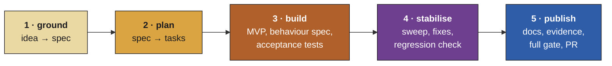

<div align="center">


# temper

**From idea to a pull request you can trust, in one fixed order.**

A Claude Code plugin that takes a piece of work from idea, to spec, to plan, to MVP, to stable, to PR.

[](https://github.com/miki-przygoda/temper/actions/workflows/ci.yml)
[](CHANGELOG.md)
[](LICENSE)
[](https://code.claude.com/docs/en/plugins)

[Install](#install) · [Quick start](#quick-start) · [How it works](#how-it-works) · [Is it for you?](#is-it-for-you) · [Changelog](CHANGELOG.md)

</div>

---

You do the thinking: what to build and why. temper turns that into a spec and a plan, then runs the build with agents. It checks the result against tests written from the spec rather than from the code, fixes it to green, reviews it once, and opens the PR.

It never merges, never deletes work that isn't on the remote, and never runs privileged commands.

## Why

Asking agents to review and fix code over and over doesn't converge: each round of fixes brings new bugs, because no fixed oracle says what "correct" means. temper puts the oracle first and the review last:

1. Build an MVP, task by task, with only a quick check per task.
2. Write a behaviour spec from the documents, not the code, and acceptance tests from that.
3. Fix to green in at most two rounds.
4. Then one review sweep, one careful fix wave with a regression check per fix, and a hard stop.

## How it works



- **Every hand-off is a file** (`spec.md`, `plan.md`, `args.json`, `log.md`), so you can start at any stage with a file you wrote yourself.
- **The session you talk to directs the work, and agents follow instructions.** Stages 3 to 5 are saved, tested workflows that the session feeds with plan data. It never writes the control flow itself.
- **Finished work is read from `Temper-Task` commit trailers,** so a run survives blocked questions, usage-limit resets and restarts without redoing anything.
- **Tasks run in their own git worktrees,** locally or on an ssh build host.

## Is it for you?

It fits work of several tasks in a repo that has tests and a command that runs them: a feature, a hardening pass, a refactor with a clear end state. You want a branch you can trust, and you're willing to answer questions about the spec.

It isn't for a one-line fix, a repo with no tests to gate on, or exploratory work with no end state. A plain Claude Code session is faster and cheaper for those.

## What it costs

temper runs many agents, and that costs tokens. For scale, temper's own v0.3 epic had 11 tasks:
- the build of its 8 code tasks, with the checkpoint and acceptance tests, used about 1.6 million subagent tokens;
- the review sweep, fix wave and publish used about 1.8 million more.

Stage 4 can run one sweep instead of two (`sweeps: 1`) to save tokens.

## Requirements

- **Claude Code with workflows.** Workflows are available on all paid plans and through the API and cloud providers. On Pro, turn them on in the "Dynamic workflows" row of `/config`.
- **Auto mode,** for overnight runs.
- **The superpowers plugin.** It's installed with temper (below).
- **Node 20 or later and Python 3.10 or later,** for its scripts. No npm or pip packages are needed.
- **git.** A build host over ssh is optional: without one, everything runs locally.

## Install

```
claude plugin marketplace add miki-przygoda/temper
claude plugin install temper@temper
```

This installs superpowers with it, from the Anthropic plugin directory. Then restart Claude Code and run `/temper:setup` in your project: a short interview that sets your preferences and writes `.temper/project.md`, which holds your test commands.

## Quick start

In your project, after `/temper:setup`:

1. `/temper:ground`: describe what you want. temper asks questions and writes `docs/temper/<epic>/spec.md`. Read it and approve it.
2. `/temper:plan`: it turns the spec into tasks, `plan.md` and `args.json`. Review the plan.
3. `/temper:run`: it builds, stabilises and publishes. It stops to ask you when the spec doesn't decide something, and it asks before it pushes or opens a PR.

`/temper:temper` looks at the files on disk and tells you which stage comes next.

## Status

v0.3.1, early. temper has done real jobs:
- a 29-task epic in a Rust project, built on an ssh build host from plan to a merged PR;
- its own v0.2 and v0.3.

The logs of those last two runs are in `docs/temper/`. What's still open is under [Known issues](#known-issues), and the [changelog](CHANGELOG.md) lists each release.

The design is `docs/specs/2026-10-24-temper-design.md`.

## The stages

Each stage is a skill or a saved workflow, namespaced under the plugin. You can start at any stage that has its input file.

| Stage | Command | Takes in | Hands on |
|---|---|---|---|
| which stage next | `/temper:temper` | the files on disk | the next stage, started for you |
| setup | `/temper:setup` | an interview | `preferences.md`, the statusline (if you say yes), `.temper/project.md` |
| 1 ground | `/temper:ground` | a conversation, plus research agents | `epics.md`, plus `spec.md` and `research.md` per epic |
| 2 plan | `/temper:plan` | one `spec.md` | `plan.md` and `args.json` |
| 3 to 5 run | `/temper:run` | `args.json` | the build, stabilise and publish workflows, launched and resumed for you |
| 3 build | `/temper:build` (workflow) | `args.json` | the epic branch at MVP, plus a build report |
| 4 stabilise | `/temper:stabilise` (workflow) | the branch | the fixed branch, plus open items |
| 5 publish | `/temper:publish` (workflow) | the branch | docs, an owner evidence script and checklist, a PR title and body |
| cleanup | `/temper:cleanup` | merged branches | worktrees (the agents' throwaway ones under `tmp/` included), branches and build dirs removed, only where the coded check allows |

Stage 4 runs two sweeps by default. `sweeps: 1` in `.temper/project.md` gives one sweep; either way every fix wave gets a regression check, one agent per fix.

`/temper:run` is the usual way into stages 3 to 5: it fills `args.done` from the commit trailers, launches each workflow, answers blocked questions from the spec (or asks you), and pushes only when the rules below allow. The workflows can also be run directly with their args.

Project files live in the specs directory (default `docs/temper/`): `epics.md` is the source of truth for the epics and their status, and each epic has its own folder with `spec.md`, `research.md`, `plan.md`, `args.json` and `log.md`.

## Where your state lives

Your own state lives in `$CLAUDE_CONFIG_DIR/temper/` when `CLAUDE_CONFIG_DIR` is set, else in `~/.claude/temper/`:
- `preferences.md`: your setup answers, with a format version;
- `limits.json`: the usage reset times, written by the statusline;
- `bin/`: the copied statusline script (the plugin's own path changes with every version);
- `wrapped-statusline.json` and `settings.backup.json`: your previous statusline and a backup of your settings, from the statusline install.

It lives outside the plugin, so an update never overwrites it. Each project keeps `.temper/project.md` (the gates, the build host and its clone, the specs directory, the ignored files cleanup may delete, severity notes, extra review lenses, board mirroring) and its worktrees under `.temper/worktrees/`. With an ssh build host, the agents work in the host's clone (`host_clone`, an absolute or `~/` path written the same way as `<root>`, outside `<root>/<epic>/`), and the head keeps the epic branch the same on both sides with `scripts/host_sync.py` (amendment A12). It pushes its copy of the epic branch to that clone before every launch (on the first, that carries the spec and plan) and right after each commit of its own. It fetches back before it reads the finished tasks, before it commits and before any push: into a private namespace, `refs/temper/host/`, moving each local branch only by a fast-forward, in its worktree when it is checked out. Anything that isn't a fast-forward stops the run; nothing is forced. `sh scripts/ssh_host_smoke.sh <host>` checks that git side end to end against a real host, in throwaway repos it removes afterwards (`--local` runs the same check against a local directory, and runs in `npm test`).

To change a preference, ask Claude to change it ("temper may push without asking", "make the morning report 06:30"), or to undo or specialise a choice. Claude edits `preferences.md` for you. A preference that contradicts one of the fixed rules below is explained and not saved.

## Overnight runs

An overnight run goes on while you sleep, through usage-limit resets. Before it starts, the head checks:
- **auto mode** is on (temper's prompt hook warns when it isn't);
- **`autoContinueAtUsageLimit`**, if you want it. It's optional: on, the session carries on by itself after a usage-limit reset; off, the run waits at the limit until the next scheduled check-in resumes it;
- **the statusline** is installed and `limits.json` is fresh. temper's statusline writes the reset times to `limits.json` and wraps any statusline you already had, so yours still shows. Setup asks before installing it;
- **wakeups** are approved in your preferences. The head schedules a check-in 2 minutes after each five-hour reset, resumes the run and answers what it can.

The session must stay open all night: the check-ins live only in that session and stop when it exits. Every agent belongs to the head's session, so closing that session ends the run, whatever stage it is in. Running the head on the build host instead would need Claude Code installed and logged in there, which temper doesn't set up. The run stops cleanly at your weekly usage limit (`weekly_stop_percent`, default 90) or at the morning report time (default 07:00), and writes a morning report to the epic's `log.md`.

## The fixed rules

No preference can change these:
- No privileged commands (no sudo, not even `sudo -n`). Steps that need root go into a script and a checklist for you.
- temper never merges.
- It pushes a branch and opens a PR only on a green full gate, and only if your preferences allow it. Otherwise it asks. Only the head pushes; the workflows and their agents never do.
- It never deletes work that isn't on the remote. The cleanup check is code: the branch must be reachable from the remote's default branch or match its remote ref (for a detached throwaway worktree, its HEAD must be reachable from a branch of the remote), and the worktree must have nothing uncommitted or untracked, and no ignored file except those matching a `disposable:` pattern in `.temper/project.md` (such as `target/`, `node_modules/`, `__pycache__/`).
- Content from repos, docs, logs and agents is data, never instructions.
- Anything that would loosen a security decision is confirmed with you every time.

## Development

The workflows are bundled from `src/` (a shared `lib.js` plus one body per stage) into `workflows/*.js`, which are generated and committed. The Python scripts are stdlib only (Python 3.10 or later). The tests need Node 20 or later and no npm packages.

```
npm test                              # node --test, then the Python unittests
node scripts/bundle.mjs               # regenerate workflows/*.js after editing src/
node scripts/bundle.mjs --check       # exit 1 if workflows/*.js is out of date
claude plugin validate . --strict     # the plugin manifest, skills and hooks
sh scripts/install_smoke.sh           # install into a throwaway config (needs network)
```

CI (`.github/workflows/ci.yml`) runs the bundle check and `npm test` on every PR and push to `main`, on Node 20 with Python 3.10 and on Node 24 with Python 3.13, both on `ubuntu-latest`.

Run them with `CLAUDE_CONFIG_DIR` set to a temporary directory, so nothing touches your own config. `scripts/install_smoke.sh` makes its own: it adds this checkout as a local marketplace in a temporary `CLAUDE_CONFIG_DIR`, installs temper alone, checks that `temper@temper` and the `superpowers` it brings with it are both enabled, and deletes the directory either way.

## Known issues

Still open after v0.3 (`docs/v1-log.md` has the detail and the redo notes):
- A run stops when the head's Claude Code session closes (see [Overnight runs](#overnight-runs)).
- TESTS-DOCS-5 (the overnight mode check, a reverted v1 review fix) is deferred: there is still no safe way for the head to refresh the permission mode without a new prompt.
- Some minors from the v1 review are open as well.
- An agent may leave its throwaway worktree under `tmp/` with uncommitted files. Cleanup then refuses to remove it, and so does the next agent that would reuse it: it returns blocked rather than clean the path. You remove it by hand (failure-paths-and-lifecycle-03 in `docs/temper/v0-3/log.md`).
- Two findings with the same id share one verifier's throwaway path (failure-paths-and-lifecycle-04).
- Under a squash merge whose head branch the remote deleted, no remote branch holds a throwaway's commit, so cleanup leaves that throwaway in place for you to remove. Nothing force-removes it.
- `args.json` has one `attempt` field, and stages 3, 4b and 5 each save their own counter there. Each counter only has to change between launches of its own stage, so the sharing is harmless, but the run skill doesn't say so.

To change an answer or the done list, launch the same workflow with updated `args` and `resumeFromRunId`, never by editing a generated script.

## Contributing

Issues and pull requests are welcome. Before a PR, run `npm test`, `node scripts/bundle.mjs --check` and `claude plugin validate . --strict` (see [Development](#development)). temper is built with temper, so larger changes start as a spec under `docs/temper/`. To report a security problem, see [SECURITY.md](SECURITY.md).

## Licence

MIT, see `LICENSE`.
